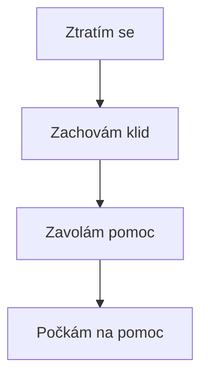

# Přežití v přírodě

## Co si vzít s sebou?
- Vodu
- Jídlo
- Mobil
- Mapu
- Lékárničku

## Když se ztratíš
1. Zachovej klid.
2. Zavolej 112.
3. Zůstaň na bezpečném místě.

## Vybavení

| Věc | Využití |
|---|---|
| Voda | Pití |
| Mapa | Orientace |
| Mobil | Pomoc |

## Výpočet

$$2 + 2 = 4$$

## Python

```python
print("Jsem připraven!")
```

## Obrázek


## Odkazy
- [Horská služba](https://www.horskasluzba.cz/)
- [Záchranná služba](https://www.zzshmp.cz/)

## Moje úkoly
- [x] Připravit batoh
- [ ] Zkontrolovat vybavení

## Postup



## Závěr
V přírodě je důležité být připravený.
